   echo Oliver Olejar" width="100%"/>

 

# 👋 About Me
 
I'm a 4th year Computer Science + Medical Biophysics student at Western University.
 
### 💼 Experience
 
- 🔜 Incoming **Software Engineer Intern** @ **Verily Health** (formerly Google Life Sciences)
- 🧠 Currently **ML Research Engineer Intern** @ **Robarts Research Institute**: improving deep learning image segmentation pipelines for Alzheimer's research
- ⚙️ **Software Engineer Intern** @ **Linamar** ('26): evaluation harnesses for agentic AI in manufacturing, plus data visualization dashboards for factory machines
- 🤖 **Software Engineer Intern** @ **Linamar** ('25): built an AI agent system that answers technician questions using RAG over robot manuals
- 🖥️ **IT Support Intern** @ **Linamar** ('24): kept hardware, software, and networks running for engineers at Linamar's Innovation Hub

 

### 🏅 Leadership
 
- **Project Manager** @ **Western AI**: led the team behind NeuralApnea Triage, an explainable ECG-based sleep apnea screener
- **Software Team Lead** @ **Western Engineering Biomedical Club**: led software for MustangMotion, an ACL rehab wearable

 

📌 More projects are pinned below and in my repos.

 

### 🔭 Areas of Interest

 

### 💬 Outside of tech ask me about...

 

## 💻 Tech Stack

<!--
## 🐍 A Snake Eating my Contributions Graph

<picture>
  <source media="(prefers-color-scheme: dark)" srcset="https://raw.githubusercontent.com/oliverolejar/oliverolejar/output/github-contribution-grid-snake-dark.svg">
  
</picture>
-->
